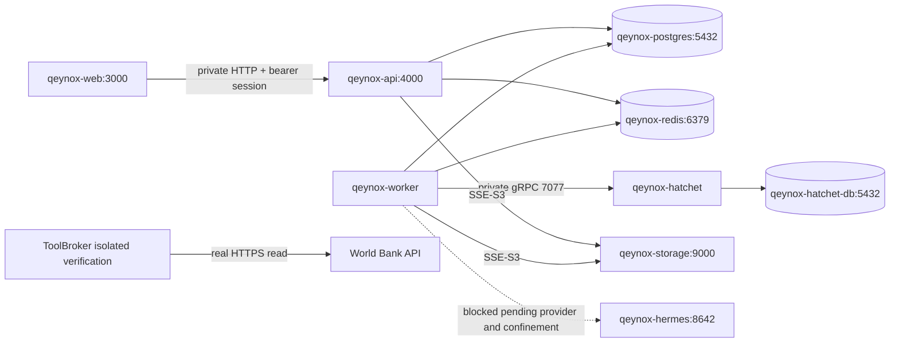

# QeyNox preproduction verification — 2026-11-13

Scope: Coolify 4.7.5 at http://31.97.158.141:8000; project `gm3bynlnlsrkikanyzvxfew7`; environment `girv53ul8pmfikflpxf9j2re` (preproduction). This is an engineering verification record, not independent production certification.

Deployed application code: `541a60d0a9e1fffe9b3756b5918f225f3666d75f`, pushed fast-forward to main after verified source corrections. All three actual running image tags were inspected and match this SHA. Documentation-only follow-up commits need no application deployment.

## Final resources

| Resource | Coolify UUID | Observed state | Tested connections / remaining gate |
|---|---|---|---|
| qeynox-web | gu5pde4uim045cfyhbzvatyn | running:healthy | Authenticated MyDash HTTP 200 and real persisted mission visible through private API; public DNS/TLS missing |
| qeynox-api | d8owo32umum050d4w7k2wvzp | running:healthy | PostgreSQL, Redis, encrypted private S3, authenticated mission creation/read; independent restart persistence verified |
| qeynox-worker | urabqgudjsqnycnicygon1vv | running:healthy | PostgreSQL, Redis, encrypted S3, Hatchet HTTP; registered Hatchet listener established |
| qeynox-postgres | cris5cemg9ja3g3ur5tyiypg | running:healthy | 11 business migrations, canonical Git LF checksums match; real DRAFT mission persisted |
| qeynox-redis | lnclv7rbyekp5ks5iokxbxvj | running:healthy | Authenticated PONG; anonymous NOAUTH; atomic shared limiter; AOF value survives restart |
| qeynox-hatchet-db | 9zbn2burfbghxjz25cpb45xv | running:healthy | Hatchet schema initialized independently; Core schema is separate |
| qeynox-hatchet | povviyiod3fxzrbhe4hzhmn1 | running:healthy | Official Lite v0.114.2; real SDK task dispatch/result; dedicated tenant/admin/token |
| qeynox-storage | 4uufasc903is4vb504v3bw9e | running:healthy | Private bucket, app-scoped credential, actual AES256 SSE-S3 uploads and signed downloads |
| qeynox-hermes | i57klnidhv6rqawzvqf5a7tz | exited, deliberately inactive | Model provider/credentials and proven native-tool/egress confinement missing |
| qeynox-anythingllm | qzgtwub6hxm3lvqomwwttbey | exited, deliberately inactive | Optional RAG; model/embeddings, reviewed adapter and isolation not configured |

Production environment `q5x4rw8twte2qim9qbmqex2k` rechecked: 0 applications, 0 services, 0 databases. No other Coolify project or the old instance was mutated. All data/runtime ports and all three application host PortBindings are empty. No public domain was created.

## Verified topology

Native Coolify `custom_network_aliases` are configured and were inspected after restart: `qeynox-api`, `qeynox-web`, `qeynox-worker`. Initial UUID-only application DNS was disproven by EAI_AGAIN; do not assume application UUIDs are DNS aliases. Standalone database UUID aliases are actually present. Service aliases `qeynox-storage` and `qeynox-hatchet` resolve. Web uses `QEYNOX_API_URL=http://qeynox-api:4000` and matching exact server-only private-origin authorization.

The destination's shared `coolify` network provides connectivity, not certified tenant segmentation or an egress firewall. No claim of Hermes confinement is made. Both agent attestations remain false, all Core provider configurations and business capabilities remain inactive, and public registration remains false.

## Evidence

- Frozen install, typecheck and production build passed. Three independent root-context Docker images built; API and Web curl-enabled images rebuilt after reproducing Coolify's generated-healthcheck failure. Health validation was not disabled. Final image health, non-root `node` user, private port bindings and common release SHA were inspected on the VPS.
- Disposable local QA: task02 **2874**, backend **28**, agent runtime **62**, connectors **48**, RaaS **47**, storage **26**, egress **47** assertions passed. Real World Bank HTTPS and real local MinIO signed/private/expired download paths were exercised.
- Shared Redis test: independent clients concurrently reserved exactly 3 of 12 calls against the same provider key; unavailable Redis fails closed. Production executor uses the configured shared Redis gate. Redis does not own business truth or durable workflows.
- Empty-preproduction CLI verified locally with NODE_ENV=production: all 11 migrations applied; nonempty target rejected. Existing QA CLI guards unchanged.
- VPS Core migration: empty target/database/user verified, atomic transaction, advisory lock and 11 canonical Git LF SHA-256 ledger entries. Subsequent comparison matched all source hashes. No production migration occurred.
- Real Hatchet infrastructure task run: `21744469-4441-45af-a9f7-13e37d6b0d87`. SDK 1.46.1 registered, dispatched, received the task and returned the nonce; temporary verification worker stopped. No agent output or business success was fabricated. Internal system tenant plus dedicated QeyNox tenant; no default administrator identity.
- VPS ToolBroker→World Bank: **48** assertions passed with a real HTTPS read, dedicated non-superuser QA role and `qeynox_qa_control` administration database; random execution database removed by the isolated QA harness. The QA role was then disabled (`NOLOGIN NOCREATEDB`), without deleting any Core data. No business connector was activated.
- Actual operator-verification mission created through deployed API: `2a3474e2-c372-440a-a669-4c777106f7e7`, workspace `969039ff-ee3e-4ceb-bc87-08aadd0721b4`. It remains **DRAFT**, has no fake plan/result and no client agent run. An isolated operator process provisioned the verification account; running HTTP registration stayed disabled.
- Deployed API wrote technical JSON/HTML exports of that real draft under S3 `verification/`; both signed reads **200**, anonymous reads **403**, actual encryption header **AES256**, exact bytes/digest checked. These are technical infrastructure exports, not delivered business results. Customer result-document export orchestration remains covered by disposable QA; real customer delivery awaits configured capabilities and Hermes.
- Deployed worker independently queried Core, reserved Redis quota, wrote/read a separate encrypted S3 verification object and reached Hatchet; real listener established with LISTEN_STRATEGY_V2.
- Independent API restart completed; authenticated GET returned the same mission in DRAFT. Redis AOF verification value also persisted through its own restart.
- Final Web check: authenticated `/fr/mydash` returned **200** without redirect and contained the real mission title, through `http://qeynox-api:4000`, after native alias restarts completed.

## Capacity

SSH measurements after deployment: **4 CPU**, **15992 MiB RAM**, **12977 MiB available**, no swap; root disk **193 GiB**, **172 GiB free**. Initial operator/SSH readings were recorded separately in infra/PREPRODUCTION.md. Five foundation containers used approximately **558 MiB total** at one idle sample, before final application measurements; this is not a load-test or a sizing guarantee.

## Remaining operator prerequisites and gates

1. Hermes: configure a real model provider securely in its resource, constrain native tools and network egress, and independently verify ToolBroker mediation before activation. No API key is invented or borrowed from another project. No real Hermes/client mission execution is claimed.
2. Public MyDash: assign an owned DNS name, TLS and appropriate public identity/gateway controls. Internal MyDash is verified; no public MyDash URL exists. Signed downloads currently use internal S3 DNS; public client downloads require a separate authenticated/signed TLS endpoint design.
3. AnythingLLM: optional, stopped; configure approved models/embeddings and reviewed consent/tenancy/API adapter before activation. No SYS_ADMIN privilege granted.
4. Production readiness: external backups and restore rehearsal, static preproduction KMS key backup/production KMS, maintained-image/security review (storage uses exact QA-tested legacy MinIO digest), identity hardening, egress/tenant segmentation, provider terms/freshness, budgets/pricing and eight operator-configured business capability slots. This task is not production certification.
5. SaaS registry: infra/connectors.registry.json records inactive declarations for AnythingLLM, LinkedIn, Workspace, Search Console, GA4, Meta, WordPress/WooCommerce, Stripe, GitHub/GitLab and World Bank. GitHub source deployment and isolated World Bank read were exercised; other business adapters/OAuth/API authorizations are not available. No content was published externally.

MCP access note: local Harness bundle already contained the Sociopulse URL and its instance-specific token-file reference. The session's preloaded `coolify` connector remained stale; all mutations used verified Streamable HTTP MCP calls to 31.97.158.141. No unrelated MCP entry was changed. A hot reload of that preloaded connector is not claimed.
